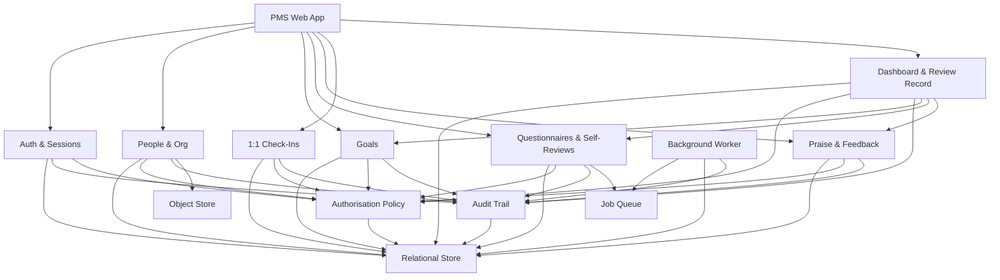
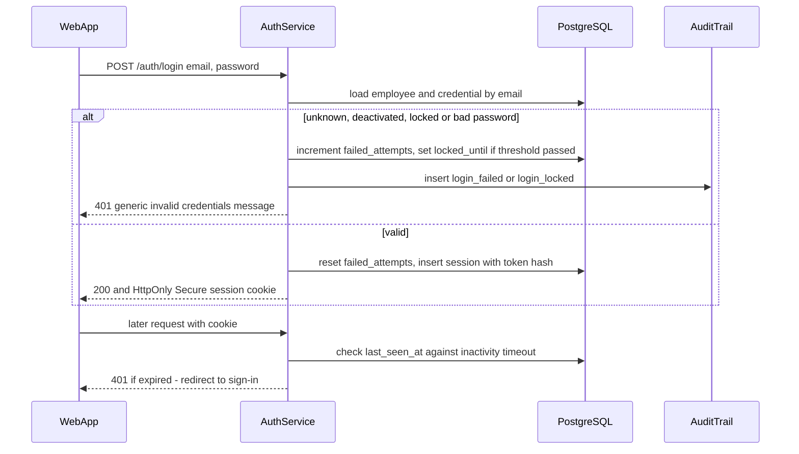
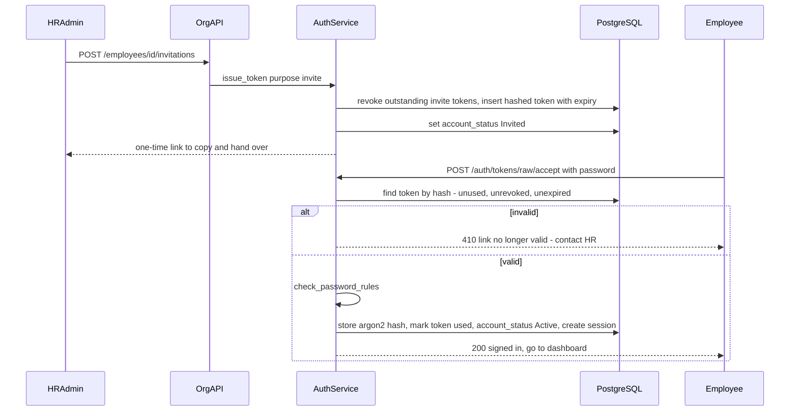
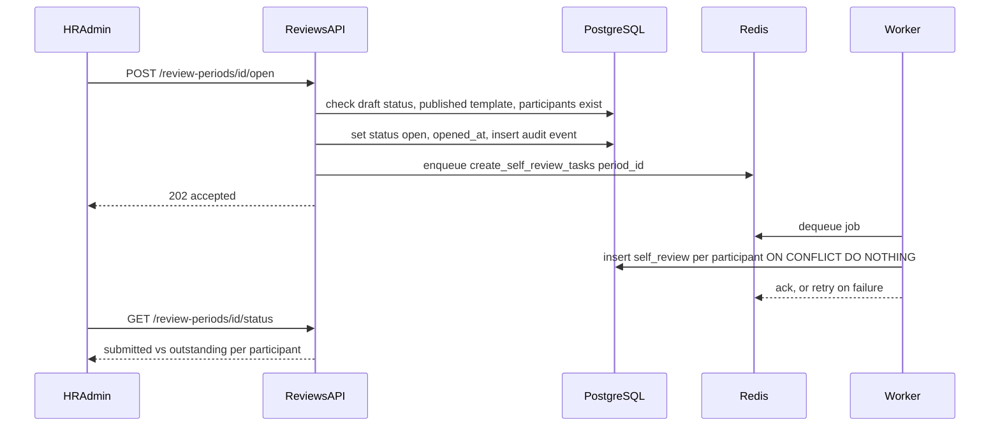
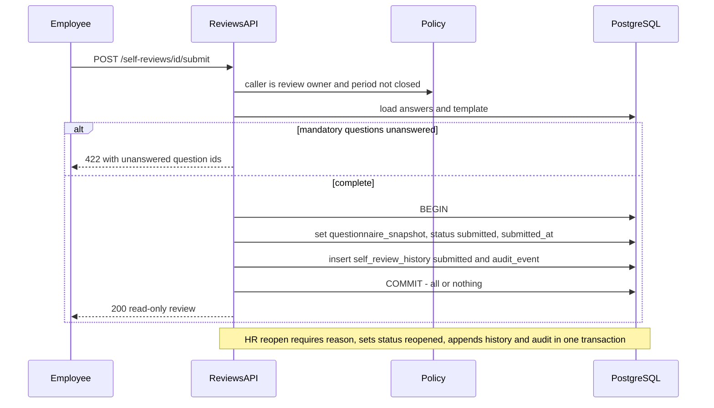
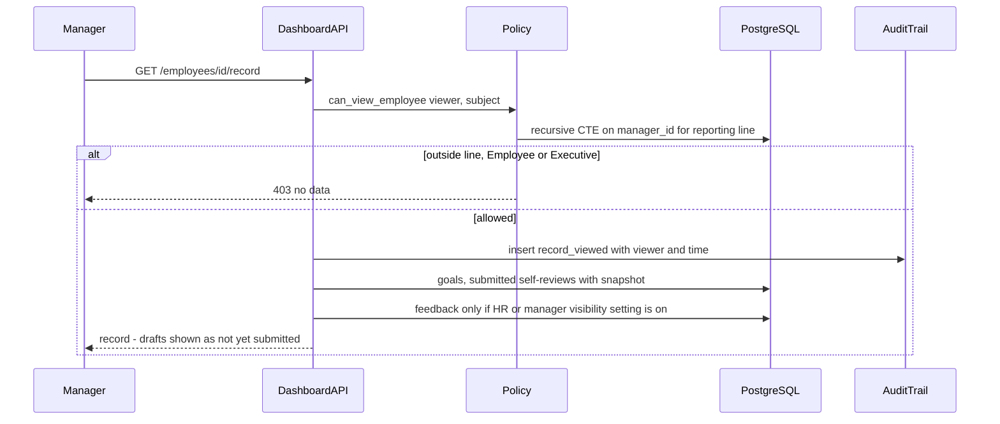
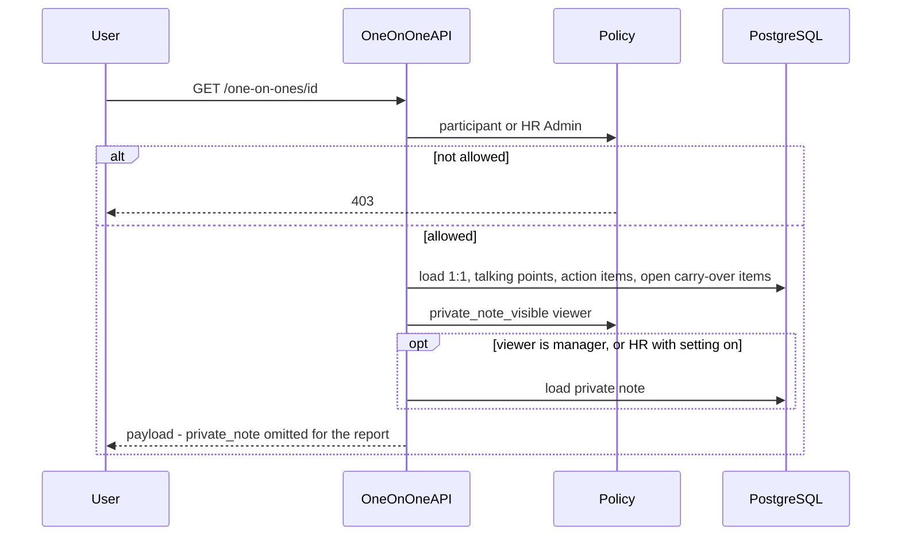
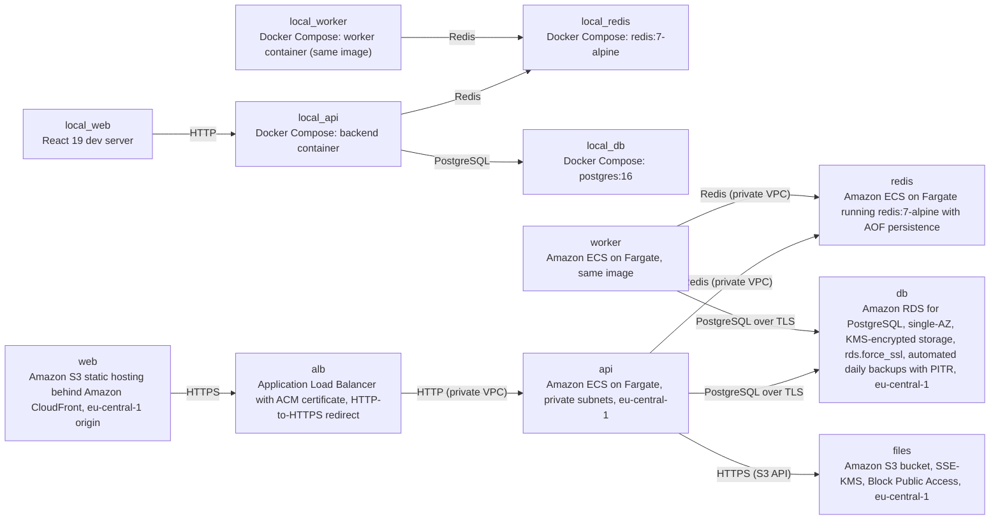

# Architecture

> Maintained by QuorQ AI SDLC. Text between `sdlc:auto` markers is regenerated; anything outside them is yours and is kept.

<!-- sdlc:auto:start narrative -->
## Overview

### ARCH-OVERVIEW · approved · source: architecture:summary

PMS is a single-company performance management web app for fewer than 200 employees. A React 19 responsive front end calls one FastAPI 0.115 modular-monolith backend on AWS, backed by PostgreSQL 16 on Amazon RDS. Architecture version 1 is marked approved.

- Status: approved. Version: 1.
- Users and roles: HR Admins, Employees, Managers, Executives.
  - HR Admins maintain people, departments, job titles, reporting lines and roles.
  - Manager status is derived from the reporting line.
  - Executives are read-only and see aggregates only.
- Sign-in onboarding: employees get HR-issued, time-limited links, because there is no email in this release.
- Core functions:
  - Goals and goal alignment, with manually typed progress.
  - Self-reviews against HR-built questionnaires.
  - Praise and feedback.
  - Manager/report 1:1s with shared agendas, action items and private manager notes.
  - A dashboard and a per-employee review record.
- Security model: a single server-side authorisation policy runs on every request. It enforces role, reporting line, feedback visibility and private-note visibility.
- Atomicity: self-review submission, locking, questionnaire snapshot and history are written in one transaction.
- Audit: an append-only audit table, protected by a database trigger, records changes and record views.
- Async: opening a review period hands self-review task creation to a Redis-backed background worker.
- Files: Amazon S3 holds profile photos.
- Hosting: one EU AWS region (eu-central-1 by default, pending confirmation).
- Protections: TLS, KMS encryption at rest, and daily RDS backups with point-in-time restore.
- Deferred or out of scope: exports, analytics, calibration, manager reviews and email.

**Related:** COMP-WEB_APP, COMP-AUTH, COMP-ACCESS_POLICY, COMP-ORG, COMP-GOALS, COMP-REVIEWS, COMP-FEEDBACK, COMP-ONE_ON_ONES, COMP-DASHBOARD, COMP-AUDIT, COMP-WORKER, COMP-QUEUE, COMP-DATABASE, COMP-FILE_STORE, SCOPE-DEFERRED

- ⚠ No approver, approval date or approval record is given for 'Status: approved'.
- ⚠ AWS region is stated as 'eu-central-1 by default, pending confirmation'. Who confirms it, and by when, is not recorded.
- ⚠ The input cites NFR-001, NFR-007, NFR-009, NFR-010, NFR-014 and NFR-017, but none of these are among the known requirement keys (US-001..US-035). The NFR source document is not available for traceability.
- ⚠ Only US-009 (profile photos) is explicitly traced to the architecture. Mapping of the other user stories (US-001..US-035) to components and endpoints is not provided.
- ⚠ Wording ambiguity: the summary says employees 'sign in through HR-issued, time-limited links', while the Auth component and endpoints describe email-and-password sign-in. The links appear to be for invitation and reset only. Confirm the intended reading.
- ⚠ No staging or pre-production environment is described. Only local (Docker Compose) and AWS production nodes are listed.
- ⚠ No observability or alerting design is given beyond a mention of CloudTrail and CloudWatch in the Cloud technology decision.
- ⚠ No industry domain skill was named, so regulation-by-regulation compliance tracing was not applied. GDPR references in the input are carried through as stated.

### SCOPE-DEFERRED · approved · source: architecture:summary

Several capabilities are explicitly excluded from this release. S3 is described as ready for the deferred export work.

- Deferred or out of scope:
  - Exports (PDF, CSV).
  - Analytics.
  - Calibration.
  - Manager reviews.
  - Email.
- Consequences of having no email:
  - Invitation and password-reset links are issued by HR and handed over manually.
  - An unread indicator replaces notifications in the Feedback module.

**Related:** TECH-FILE_STORAGE, ARCH-OVERVIEW

- ⚠ The input does not say which items are deferred (planned later) and which are permanently out of scope.
- ⚠ How HR delivers invitation and reset links to employees without email is not described.

### COMP-WEB_APP · approved · source: architecture:component:web_app

PMS Web App is a responsive, English-only React 19 UI covering all employee, manager, HR and executive screens. It is presentation only: authorisation is never enforced client-side.

- Technology: React 19.
- Screens:
  - Dashboard.
  - My goals.
  - Team goals.
  - Goal alignment.
  - Feedback.
  - 1:1s.
  - Self-review.
  - Review record.
  - Profile.
  - HR directory.
  - Org settings.
  - Questionnaires.
  - Review periods.
  - Settings.
- Shows field-level validation, warnings and empty states.
- Tells the user who can read feedback, and whether private notes are visible, before the user acts.
- Uses no client-side authorisation as a security control.
- Single-column reflow on phones (NFR-017, per Frontend decision).
- Hosting: static build on S3 behind CloudFront.

**Related:** TECH-FRONTEND, DEPLOY-AWS, NFR-017

- ⚠ Accessibility targets (e.g. WCAG level) are not stated.

### COMP-AUTH · approved · source: architecture:component:auth

Auth & Sessions (FastAPI) handles email/password sign-in with argon2, account lockout, opaque server-side sessions and hashed single-use invitation and reset tokens.

- Sign-in and passwords:
  - Email and password sign-in.
  - Passwords hashed with argon2.
  - Failure messages are generic.
  - Per-account lockout after the configured threshold; the lock is audited.
  - Password rules are read from settings.
- Sessions:
  - Opaque server-side sessions carried in an HttpOnly Secure cookie.
  - Ended by sign-out or by the configured inactivity timeout.
- Invitation and reset tokens:
  - Stored hashed.
  - Single-use, time-limited and revocable.
  - Only the newest token is valid.
- Deactivated employees are refused.

**Related:** CP-SIGNIN, CP-INVITATION, API-AUTH, ENT-AUTH, COMP-AUDIT

- ⚠ Default values for the lockout threshold, lockout duration, inactivity timeout, token lifetime and password rules are not given.
- ⚠ MFA is not mentioned.
- ⚠ The cookie SameSite and CSRF protection approach is not specified.

### COMP-ACCESS_POLICY · approved · source: architecture:component:access_policy

A central server-side authorisation policy runs as a FastAPI dependency on every route. Refusals return 403 or 404 with no data.

- Runs as a FastAPI dependency on every route.
- Inputs:
  - Caller role.
  - Derived manager status.
  - Reporting line, computed with a recursive CTE over employee.manager_id.
- Rules applied:
  - Executive read-only and aggregate-only rules.
  - The manager feedback visibility setting.
  - The HR private-note visibility setting.
- Refusals return 403 or 404 with no data.
- Traced by the input to NFR-001 and to GDPR Art. 5(1)(f) and Art. 32 (least privilege).

**Related:** NFR-001, CP-RECORD-VIEW, CP-ONE_ON_ONE, COMP-FEEDBACK, COMP-ONE_ON_ONES, COMP-DASHBOARD

- ⚠ The rule for when to return 403 versus 404 is not specified.

### COMP-ORG · approved · source: architecture:component:org

People & Org manages employees, departments, job titles, reporting lines, roles, leaver deactivation, the self-owned profile and HR-maintained system settings.

- Covers employee records, departments and job titles.
- Reporting lines: self-manager assignments and cycles are rejected.
- Role assignment includes a last-HR-Admin guard.
- Leavers:
  - Deactivated only after their direct reports are reassigned.
  - Never hard-deleted.
- Self-owned profile:
  - Display name and pronouns.
  - Photo stored in S3 (US-009).
- System settings are maintained by HR.

**Related:** API-PEOPLE, API-PROFILE, ENT-ORG, US-009, COMP-FILE_STORE

- ⚠ How long deactivated employees' data is retained is not specified. See SEC-GDPR.

### COMP-GOALS · approved · source: architecture:component:goals

Goals supports personal, department and company goals with weighting, manual progress tracking, parent alignment and manager comments.

- Goal levels: personal, department and company.
- Goal fields include target, due date and weighting.
- A warning appears when the weighting total for a period is off.
- Progress and status are typed in by the owner; progress history is kept.
- Parent alignment:
  - Cycle detection.
  - A parent goal cannot be deleted while child goals are aligned to it.
- Team goals view.
- Manager comments.
- An overdue flag is computed on read.

**Related:** API-GOALS, ENT-GOALS, COMP-AUDIT

- ⚠ The target weighting total that triggers the warning (e.g. 100%) is not stated.

### COMP-REVIEWS · approved · source: architecture:component:reviews

Questionnaires & Self-Reviews covers rating scales, questionnaire templates, the review period lifecycle, self-review draft/submit/reopen, history and the submission status board.

- Rating scales.
- Questionnaire templates:
  - Made up of competencies and questions.
  - Validated on publish.
- Review periods:
  - Move from draft to open to closed.
  - Have participants.
- Self-reviews:
  - Saved as drafts, then submitted.
  - Submission freezes a questionnaire snapshot and locks the review.
  - An HR reopen requires a reason.
- Append-only review history (NFR-010).
- Submission status board.

**Related:** NFR-010, CP-REVIEW-OPEN, CP-SELF-REVIEW, API-REVIEWS, ENT-REVIEWS

- ⚠ Whether a closed period can be reopened is not stated.

### COMP-FEEDBACK · approved · source: architecture:component:feedback

Praise & Feedback lets employees send praise or constructive feedback to active colleagues. Sent items are read-only and can only be withdrawn.

- Praise and constructive feedback can be sent to active colleagues.
- Employees cannot send feedback to themselves.
- Sent items are read-only and can only be withdrawn; a withdrawal is audited.
- Authors can optionally link a goal they are entitled to view.
- Received and Given lists can be filtered by type and date.
- An unread indicator replaces notifications.
- An audience statement reflects the current visibility setting.

**Related:** API-FEEDBACK, ENT-FEEDBACK, COMP-ACCESS_POLICY, COMP-AUDIT

- ⚠ The possible values and default of the manager feedback visibility setting are not given.

### COMP-ONE_ON_ONES · approved · source: architecture:component:one_on_ones

1:1 Check-Ins run only between a manager and a direct report. They have a shared agenda, action items with carry-over, and private manager notes stored separately.

- A 1:1 can only be created between a manager and a direct report.
- Shared agenda of talking points:
  - The author can edit and delete their own points.
  - The other participant can mark points as discussed.
  - Points can be reordered.
- Action items:
  - Have an owner and a due date.
  - Can be completed.
  - Carry over to later 1:1s.
- Private manager notes:
  - Live in a separate table.
  - Are never serialised for the report (NFR-007).

**Related:** NFR-007, CP-ONE_ON_ONE, API-1ON1, ENT-1ON1

- ⚠ The carry-over rule for action items (e.g. which items carry and to which 1:1) is not defined.
- ⚠ There is no endpoint for editing or deleting action items.

### COMP-DASHBOARD · approved · source: architecture:component:dashboard

Dashboard & Review Record serves the personal dashboard, the employee's own record, audited per-employee records for managers in the line and HR, and an aggregate-only executive summary.

- Personal dashboard:
  - Goals.
  - Recent feedback.
  - Reviews.
  - A Needs-your-attention list.
- My record: the employee's own history, grouped by period.
- Per-employee review record:
  - Available to managers in the reporting line and to HR.
  - Every view is audited.
- Executives get an aggregate counts summary only, with no individual records.

**Related:** API-DASH, CP-RECORD-VIEW, COMP-AUDIT

- ⚠ The items that populate the Needs-your-attention list are not enumerated.

### COMP-AUDIT · approved · source: architecture:component:audit

Audit Trail is an append-only audit_event table in PostgreSQL. A trigger rejects UPDATE and DELETE, and the app database role has INSERT and SELECT only.

- Append-only audit_event table.
- A PostgreSQL trigger rejects UPDATE and DELETE.
- The app database role has INSERT and SELECT only.
- Recorded events, each with actor and timestamp:
  - Goal edits.
  - Progress updates.
  - Submissions.
  - Reopenings.
  - Withdrawals.
  - Lockouts.
  - Role changes.
  - Review-record views.
- Traced by the input to NFR-009 and GDPR accountability.

**Related:** NFR-009, ENT-SYSTEM, TECH-DATABASE, SEC-GDPR

- ⚠ No audit retention period is specified.
- ⚠ Who may read GET /audit-events is not stated.
- ⚠ Whether the audit list should also cover employee create, deactivate, settings changes and invitation issue is not stated.

### COMP-WORKER · approved · source: architecture:component:worker

The background worker consumes jobs from the Redis queue, mainly to create self-review tasks when a period opens. It is idempotent per participant and retries on failure.

- Consumes Redis queue jobs; runs as an RQ worker.
- Main job: create self-review tasks for every participant when a period opens.
- Idempotent per participant.
- Retries on failure (NFR-014).
- Shares the backend codebase and models (same image).

**Related:** NFR-014, CP-REVIEW-OPEN, COMP-QUEUE

- ⚠ Retry count, backoff and dead-letter handling are not specified.
- ⚠ How HR is told about a permanently failed job is not specified.

### COMP-QUEUE · approved · source: architecture:component:queue

A Redis job queue sits between the API and the worker. It is described as durable.

- Described as a durable job queue between the API and the worker.
- Deployed as redis:7-alpine with AOF persistence.

**Related:** TECH-QUEUE, COMP-WORKER, DEPLOY-AWS

- ⚠ The queue is called durable, but in production Redis runs as an ECS Fargate task. No persistent volume (e.g. EFS) is specified for the AOF file, so durability across task restarts is unconfirmed.

### COMP-DATABASE · approved · source: architecture:component:database

PostgreSQL 16 on Amazon RDS is the system of record for all entities, settings and audit data.

- System of record for all entities, settings and audit data.
- Runs on Amazon RDS.
- KMS encryption at rest.
- TLS-only connections.
- Automated daily backups with point-in-time restore.
- Hosted in an EU region.
- Traced by the input to GDPR Art. 32 and data residency.

**Related:** TECH-DATABASE, DEPLOY-AWS, SEC-GDPR

- ⚠ No backup retention period, RPO or RTO is stated.
- ⚠ The deployment is single-AZ, so there is no stated availability target or failover approach.

### COMP-FILE_STORE · approved · source: architecture:component:file_store

Amazon S3 stores profile photos privately with SSE-KMS and serves them through short-lived presigned URLs.

- Stores profile photos.
- SSE-KMS encryption.
- Public access blocked.
- Photos served through short-lived presigned URLs.
- Same EU region as the rest of the system.

**Related:** US-009, TECH-FILE_STORAGE, COMP-ORG

- ⚠ Allowed photo file types and size limits are not given.
- ⚠ Whether photos are deleted when an employee is deactivated is not given.

### CP-SIGNIN · approved · source: architecture:critical_path:sign-in

Critical path: sign-in with lockout and server-side session issuance.

1. Validate credentials without revealing whether the email exists.
2. Apply the configurable lockout threshold and audit the block.
3. Refuse deactivated employees.
4. Issue a server-side session whose inactivity timeout comes from settings.

**Related:** COMP-AUTH, COMP-AUDIT, API-AUTH, ENT-AUTH

### CP-INVITATION · approved · source: architecture:critical_path:invitation

Critical path: HR issues, reissues and revokes invitation or reset links, and the employee accepts one to activate their account.

1. HR issues an invitation link (or a password-reset link) that is single-use and time-limited.
2. Issuing a new link revokes earlier outstanding ones.
3. Accepting the link sets a rule-compliant password, activates the account and signs the person in.

**Related:** COMP-AUTH, API-AUTH, API-PEOPLE, ENT-AUTH

- ⚠ The input does not say whether a password reset also activates the account or only sets the password.

### CP-REVIEW-OPEN · approved · source: architecture:critical_path:open-review-period

Critical path: HR opens a review period; the API returns immediately and the worker creates self-review tasks asynchronously.

1. HR opens a draft period.
2. The API validates the period, flips its status, enqueues a job and returns immediately.
3. The worker creates one self-review task per participant, idempotently.

**Related:** COMP-REVIEWS, COMP-WORKER, COMP-QUEUE, NFR-014, API-REVIEWS

- ⚠ The checks performed when the period is validated before opening are not enumerated.
- ⚠ It is not stated whether the status flip and the enqueue are atomic. If the enqueue fails after the flip, recovery is undefined.

### CP-SELF-REVIEW · approved · source: architecture:critical_path:submit-reopen

Critical path: atomic self-review submission and HR reopen.

1. Submission validates mandatory answers.
2. In one transaction, it freezes the questionnaire snapshot, locks the review, and appends history and audit entries.
3. An HR reopen requires a reason and is recorded the same way.

**Related:** COMP-REVIEWS, COMP-AUDIT, NFR-009, NFR-010, API-REVIEWS, ENT-REVIEWS

### CP-RECORD-VIEW · approved · source: architecture:critical_path:review-record

Critical path: authorised, audited view of an employee's review record.

1. The policy checks role and reporting line.
2. Feedback visibility is applied.
3. The view is audited.
4. The response returns goals, submitted self-reviews (snapshots only) and permitted feedback.
5. Draft review content is never returned to managers.

**Related:** COMP-ACCESS_POLICY, COMP-DASHBOARD, COMP-AUDIT, API-DASH

### CP-ONE_ON_ONE · approved · source: architecture:critical_path:one-on-one

Critical path: loading a 1:1 with private-note filtering.

1. Only the two participants (or HR) can open a 1:1.
2. Private notes are read from a separate table.
3. Notes are included only for the manager, or for HR when the HR setting allows.
4. The response tells the manager whether HR can read the notes.

**Related:** COMP-ONE_ON_ONES, COMP-ACCESS_POLICY, NFR-007, API-1ON1, ENT-1ON1

### ENT-ORG · approved · source: architecture:entities

Data model for people and organisation: department, job title and employee.

- department: id, name, created_at.
- job_title: id, name.
- employee: id, full_name, work_email, display_name, pronouns, photo_s3_key, job_title_id, department_id, manager_id, role, status, leaving_date, account_status, updated_at.

**Related:** COMP-ORG

- ⚠ The difference between employee.status and employee.account_status, and their allowed values, is not defined.

### ENT-AUTH · approved · source: architecture:entities

Data model for authentication: credentials, account tokens and sessions.

- user_credential: employee_id, password_hash, failed_attempts, locked_until, password_changed_at.
- account_token: id, employee_id, purpose, token_hash, expires_at, used_at, revoked_at, issued_by.
- session: id, employee_id, token_hash, last_seen_at, revoked_at.

**Related:** COMP-AUTH

### ENT-GOALS · approved · source: architecture:entities

Data model for goals, progress updates and goal comments.

- goal: id, level, owner_id, department_id, parent_goal_id, title, description, target, due_date, period, weighting, progress, status, updated_by, updated_at, deleted_at (soft delete).
- goal_progress_update: id, goal_id, progress, status, updated_by, created_at.
- goal_comment: id, goal_id, author_id, body, created_at.

**Related:** COMP-GOALS

- ⚠ It is not defined whether goal.period references review_period or is a free-form value.

### ENT-REVIEWS · approved · source: architecture:entities

Data model for rating scales, questionnaires, review periods, participants, self-reviews, answers and history.

- rating_scale: id, name, labels.
- questionnaire_template: id, name, status, rating_scale_id, updated_at.
- competency: id, template_id, name, position.
- question: id, competency_id, text, type, mandatory, position.
- review_period: id, name, template_id, start_date, end_date, submission_deadline, status, opened_at.
- review_participant: period_id, employee_id.
- self_review: id, period_id, employee_id, status, questionnaire_snapshot (JSONB per the Database decision), submitted_at, updated_at.
- self_review_answer: id, self_review_id, question_id, rating, comment.
- self_review_history: id, self_review_id, action, actor_id, reason, created_at.

**Related:** COMP-REVIEWS

### ENT-FEEDBACK · approved · source: architecture:entities

Data model for praise and feedback items.

- feedback: id, author_id, recipient_id, type, body, goal_id, created_at, read_at, withdrawn_at, withdrawn_by.

**Related:** COMP-FEEDBACK

### ENT-1ON1 · approved · source: architecture:entities

Data model for 1:1s, private notes, talking points and action items.

- one_on_one: id, manager_id, report_id, meeting_date, created_by, updated_at.
- one_on_one_private_note: one_on_one_id, manager_id, body, updated_at.
- talking_point: id, one_on_one_id, author_id, body, position, discussed.
- action_item: id, one_on_one_id, owner_id, description, due_date, completed_at, completed_by.

**Related:** COMP-ONE_ON_ONES

- ⚠ No field records action-item carry-over, so the carry-over mechanism is unclear.

### ENT-SYSTEM · approved · source: architecture:entities

Data model for system settings and the audit trail.

- system_setting: key, value, updated_by, updated_at.
- audit_event: id, actor_id, action, entity_type, entity_id, subject_employee_id, details, created_at.

**Related:** COMP-AUDIT, COMP-ORG

- ⚠ The full list of setting keys is not given. Known keys implied by the input are: lockout threshold, inactivity timeout, password rules, manager feedback visibility and HR private-note visibility.

### API-AUTH · approved · source: architecture:endpoints

Authentication and session endpoints.

- POST /auth/login: sign in with email and password. Gives a generic error on failure and applies lockout.
- POST /auth/logout: end the current session.
- GET /auth/me: current user with role and derived is_manager.
- POST /auth/password: change password by supplying the current one.
- GET /auth/tokens/{token}: check whether an invitation or reset link is valid.
- POST /auth/tokens/{token}/accept: set a password using an invite or reset link. The link is single-use.

**Related:** COMP-AUTH, CP-SIGNIN, CP-INVITATION

### API-PEOPLE · approved · source: architecture:endpoints

Endpoints for employees, invitations, departments and job titles.

- GET /employees: employee directory and pickers. Use active_only for pickers. Rows missing a manager are flagged.
- POST /employees: create an employee record.
- PATCH /employees/{id}: edit employee details or role. The last-HR-Admin guard applies.
- PUT /employees/{id}/manager: set or reassign a manager. Self-management and circular lines are rejected.
- POST /employees/{id}/deactivate: deactivate a leaver and revoke their sessions. Requires direct reports to be reassigned first.
- POST /employees/{id}/invitations: issue or reissue an invitation link. Earlier links are revoked.
- DELETE /employees/{id}/invitations: revoke an outstanding invitation.
- POST /employees/{id}/password-resets: issue a single-use password-reset link.
- GET /departments: list departments with active employee counts.
  - Sibling POST, PATCH and DELETE are HR only.
  - DELETE is blocked while employees are assigned.
- GET /job-titles: list job titles. Sibling POST and PATCH (rename) are HR only.

**Related:** COMP-ORG, CP-INVITATION

- ⚠ There is no reactivation endpoint for deactivated employees.
- ⚠ There is no delete endpoint for job titles.
- ⚠ It is not stated whether these are intentionally omitted.

### API-PROFILE · approved · source: architecture:endpoints

Endpoints for the employee's own profile.

- GET /me/profile: own profile. HR-owned fields are flagged read-only.
- PATCH /me/profile: update self-owned fields.
- PUT /me/profile/photo: upload a profile photo to S3.

**Related:** COMP-ORG, COMP-FILE_STORE, US-009

### API-GOALS · approved · source: architecture:endpoints

Endpoints for goals, progress, alignment and comments.

- GET /goals: list goals for the caller, or for a permitted employee. Includes overdue flags and a weighting warning.
- POST /goals: create a goal. Company and department levels are HR only.
- PATCH /goals/{id}: edit goal fields or alignment. Audited; alignment cycles are rejected.
- POST /goals/{id}/progress: record manual progress and status.
- GET /goals/{id}: goal detail with the visible aligned children, comments and progress history.
- DELETE /goals/{id}: soft-delete a goal. Blocked while child goals are aligned.
- GET /goals/parent-options: company goals plus goals of the caller's own department.
- GET /team/goals: direct reports with their goals.
- POST /goals/{id}/comments: add a comment to a goal.

**Related:** COMP-GOALS

- ⚠ Who may comment on a goal (manager only, or others too) is not restated at endpoint level.

### API-REVIEWS · approved · source: architecture:endpoints

Endpoints for rating scales, questionnaires, review periods and self-reviews.

- POST /rating-scales: create a rating scale with points and labels.
- POST /questionnaires: create or replace a questionnaire template with competencies and questions. Sibling GET and PUT exist.
- POST /questionnaires/{id}/publish: publish a template. Blocked when it has no questions.
- POST /review-periods: create a draft review period. PATCH and PUT /participants are available while it is draft.
- DELETE /review-periods/{id}/participants/{employee_id}: remove a participant. Blocked if they have already submitted.
- POST /review-periods/{id}/open: open the period. Self-review tasks are created by a queued job.
- POST /review-periods/{id}/close: close the period. Submission is no longer possible.
- GET /review-periods/{id}/status: submitted vs outstanding participants.
- GET /self-reviews/{id}: a self-review. Drafts are visible only to the owner; submitted reviews are rendered from the snapshot.
- PUT /self-reviews/{id}/answers: save a draft.
- POST /self-reviews/{id}/submit: submit and lock the review.
- POST /self-reviews/{id}/reopen: reopen for editing with a reason.
- GET /self-reviews/{id}/history: chronological, immutable review history.

**Related:** COMP-REVIEWS, CP-REVIEW-OPEN, CP-SELF-REVIEW

- ⚠ No list or read endpoints are given for rating scales or review periods (e.g. GET /rating-scales, GET /review-periods).
- ⚠ There is no endpoint for an employee to find their own self-review id or task list, unless GET /me/dashboard provides it.
- ⚠ Participant removal is described as available while a period is draft, but DELETE is guarded only by 'already submitted'. This implies removal may also be possible while the period is open. Clarify.

### API-FEEDBACK · approved · source: architecture:endpoints

Endpoints for praise and feedback.

- GET /feedback/audience: who will be able to read feedback sent to a recipient.
- POST /feedback: send praise or constructive feedback.
- GET /feedback: received or given feedback, newest first.
- POST /feedback/{id}/withdraw: withdraw sent feedback. Audited.

**Related:** COMP-FEEDBACK

- ⚠ There is no explicit endpoint for marking feedback read (feedback.read_at). The trigger for setting it is unstated.

### API-1ON1 · approved · source: architecture:endpoints

Endpoints for 1:1s, talking points, action items and private notes.

- GET /one-on-ones: list my 1:1s and open action items.
- POST /one-on-ones: create a 1:1. A report is auto-paired with their manager.
- GET /one-on-ones/{id}: 1:1 detail with agenda, action items and carry-over. The private note is only included where permitted.
- PATCH /one-on-ones/{id}: change the meeting date.
- POST /one-on-ones/{id}/talking-points: add a talking point.
  - PATCH and DELETE /talking-points/{id} are author only.
  - Exception: either participant can set 'discussed'.
- PUT /one-on-ones/{id}/talking-points/order: reorder the agenda.
- POST /one-on-ones/{id}/action-items: add an action item.
- POST /action-items/{id}/complete: mark an action item complete.
- PUT /one-on-ones/{id}/private-note: save the manager's private note.

**Related:** COMP-ONE_ON_ONES, CP-ONE_ON_ONE

- ⚠ There is no endpoint to delete a 1:1.
- ⚠ Which participants may reorder the agenda is not stated.

### API-DASH · approved · source: architecture:endpoints

Endpoints for the dashboard, review records and the org summary.

- GET /me/dashboard: own goals, recent feedback, reviews, needs-attention items and the unread feedback count.
- GET /me/record: own full history grouped by period.
- GET /employees/{id}/record: employee review record. Every view is audited.
- GET /org/summary: aggregate counts only (headcount, goals by status, self-review submission counts). No individual data.

**Related:** COMP-DASHBOARD, CP-RECORD-VIEW

### API-SETTINGS-AUDIT · approved · source: architecture:endpoints

Endpoints for system settings and the audit trail.

- GET /settings: read system settings. PUT updates them and is HR only.
- GET /audit-events: read the audit trail. Read-only, with no edit or delete endpoints.

**Related:** COMP-ORG, COMP-AUDIT

- ⚠ Who may call GET /settings and GET /audit-events is not specified.
- ⚠ Audit-event filtering and pagination are not specified.

### DEPLOY-LOCAL · approved · source: architecture:deployment_nodes

The local development environment uses Docker Compose for the backend services and a Node dev server for the front end.

- local_api: Docker Compose backend container running FastAPI 0.115 under uvicorn.
- local_worker: Docker Compose worker container (same image) running an RQ worker.
- local_redis: Docker Compose redis:7-alpine.
- local_db: Docker Compose postgres:16.
- local_web: React 19 dev server (Node).

**Related:** COMP-WORKER, COMP-QUEUE, COMP-DATABASE, COMP-WEB_APP

- ⚠ There is no local substitute for S3 photo storage (e.g. MinIO or LocalStack).

### DEPLOY-AWS · approved · source: architecture:deployment_nodes

The production topology on AWS is in eu-central-1: CloudFront/S3 for the front end, an ALB, ECS Fargate for the API, worker and Redis, RDS PostgreSQL and an S3 files bucket.

- web: React 19 static build on Amazon S3 static hosting behind Amazon CloudFront (eu-central-1 origin).
- alb: Application Load Balancer with an ACM certificate and HTTP-to-HTTPS redirect.
- api: Amazon ECS on Fargate in private subnets, eu-central-1, running FastAPI 0.115.
- worker: Amazon ECS on Fargate (same image) running an RQ worker.
- redis: Amazon ECS on Fargate running redis:7-alpine with AOF persistence.
- db: Amazon RDS for PostgreSQL 16.
  - Single-AZ.
  - KMS-encrypted storage.
  - rds.force_ssl.
  - Automated daily backups with PITR.
  - eu-central-1.
- files: Amazon S3 bucket with SSE-KMS and Block Public Access, eu-central-1.

**Related:** TECH-CLOUD, COMP-WEB_APP, COMP-DATABASE, COMP-QUEUE, COMP-WORKER, COMP-FILE_STORE

- ⚠ Region eu-central-1 is pending confirmation.
- ⚠ A single-AZ RDS deployment has no failover. No availability target or rationale is recorded.
- ⚠ Redis on Fargate has no persistent volume specified for AOF, so its durability is unconfirmed.
- ⚠ CloudFront has edge locations outside the EU. The input does not address whether this affects the data-residency claim. Static assets only are implied.
- ⚠ No CI/CD pipeline, infrastructure-as-code tool, secrets management approach or task scaling settings are described.
- ⚠ CloudTrail and CloudWatch are mentioned in TECH-CLOUD but are not listed as deployment nodes.

### TECH-FRONTEND · approved · source: architecture:technology_decisions:frontend

React 19 was chosen for the front end over Vue and Angular, as part of the approved stack.

- Decision: React 19.
- Alternatives considered: Vue, Angular.
- Rationale as stated:
  - Part of the approved stack.
  - Delivers one responsive, English-only web app covering employee, manager, HR and executive screens.
  - Single-column reflow on phones (NFR-017).
- Served as a static build from S3 and CloudFront in the EU region.

**Related:** COMP-WEB_APP, NFR-017

- ⚠ Who approved the stack, and when, is not recorded.

### TECH-BACKEND · approved · source: architecture:technology_decisions:backend

FastAPI 0.115 was chosen for the backend over Django and Express, built as a modular monolith.

- Decision: FastAPI 0.115 as a modular monolith.
- Alternatives considered: Django, Express.
- Rationale as stated:
  - Part of the approved stack.
  - Pydantic validation produces field-level 422 messages.
  - A shared policy dependency runs on every route for least privilege (NFR-001).
  - The same image runs the RQ worker.
  - Transactional submit and lock logic uses SQLAlchemy sessions.

**Related:** COMP-ACCESS_POLICY, COMP-WORKER, CP-SELF-REVIEW, NFR-001

### TECH-DATABASE · approved · source: architecture:technology_decisions:database

PostgreSQL 16 was chosen over MySQL for relational integrity, recursive CTEs, JSONB and trigger-enforced append-only tables.

- Decision: PostgreSQL 16.
- Alternative considered: MySQL.
- Rationale as stated:
  - Part of the approved stack.
  - Relational integrity for reporting lines and goal alignment.
  - Recursive CTEs for reporting-line and cycle checks.
  - JSONB for questionnaire snapshots and settings.
  - Triggers make the audit and history tables append-only.
  - One transaction covers submit, lock and audit (NFR-009, NFR-010).
- Runs on RDS with KMS encryption and daily backups (GDPR Art. 32).

**Related:** COMP-DATABASE, COMP-AUDIT, NFR-009, NFR-010, SEC-GDPR

- ⚠ This decision says triggers protect both the audit and history tables, but the Audit component describes the trigger only for audit_event. The trigger on self_review_history should be confirmed.

### TECH-CLOUD · approved · source: architecture:technology_decisions:cloud

AWS was chosen as the cloud provider over Azure and GCP.

- Decision: AWS.
- Alternatives considered: Azure, GCP.
- Rationale as stated:
  - Part of the approved stack.
  - EU region for data residency (GDPR).
  - RDS automated backups with PITR.
  - KMS encryption.
  - ECS Fargate for small always-on tasks.
  - ACM for TLS.
  - CloudTrail and CloudWatch for access and backup logging.

**Related:** DEPLOY-AWS, SEC-GDPR

- ⚠ CloudTrail and CloudWatch configuration (log retention, alarms) is not specified.

### TECH-QUEUE · approved · source: architecture:technology_decisions:queue

Redis was chosen as the job queue over a PostgreSQL-backed job table, so that opening a period returns immediately and failed jobs retry.

- Decision: Redis.
- Alternative considered: a PostgreSQL-backed job table.
- Rationale as stated:
  - Approved service.
  - Opening a review period queues self-review task creation, so HR's request returns immediately.
  - Failed jobs retry (NFR-014).
- Runs as the approved redis:7-alpine container with AOF persistence.

**Related:** COMP-QUEUE, COMP-WORKER, CP-REVIEW-OPEN, NFR-014

- ⚠ The reason a managed service (e.g. ElastiCache) was not used is not recorded, nor is the persistent storage for the AOF file on Fargate.

### TECH-FILE_STORAGE · approved · source: architecture:technology_decisions:file_storage

Amazon S3 was chosen for file storage over bytea columns in PostgreSQL.

- Decision: Amazon S3.
- Alternative considered: bytea in PostgreSQL.
- Rationale as stated:
  - Approved service.
  - Holds profile photos (US-009) outside the database.
  - SSE-KMS, private access and presigned URLs, in the EU region.
  - Ready for the deferred PDF, CSV and export work.

**Related:** COMP-FILE_STORE, US-009, SCOPE-DEFERRED

### SEC-GDPR · approved · source: architecture:summary

This entry collects the security and GDPR controls cited in the architecture input. It is traceability for human confirmation, not legal advice.

- GDPR Art. 5(1)(f) and Art. 32 (least privilege): central server-side authorisation policy (access_policy, NFR-001).
- GDPR accountability: append-only audit_event with trigger and INSERT/SELECT-only database role (audit, NFR-009).
- GDPR Art. 32 (security of processing):
  - TLS everywhere (ALB/ACM, rds.force_ssl).
  - KMS encryption at rest for RDS and S3.
  - Daily backups with PITR.
- Data residency (GDPR): a single EU region for the database, file store and API.
- Other controls:
  - Hashed passwords (argon2) and hashed tokens.
  - HttpOnly Secure session cookies.
  - Account lockout.
  - Presigned short-lived photo URLs.

**Related:** COMP-ACCESS_POLICY, COMP-AUDIT, COMP-DATABASE, COMP-FILE_STORE, TECH-CLOUD, TECH-DATABASE, NFR-001, NFR-009

- ⚠ The design does not address data retention or erasure (e.g. GDPR Art. 17 right to erasure, storage limitation). Employees are never hard-deleted and audit rows are immutable.
- ⚠ The design does not address data subject access or portability (GDPR Art. 15/20). Exports are deferred.
- ⚠ No DPIA, lawful-basis or processor (AWS DPA) documentation is referenced.
- ⚠ The EU region is not yet confirmed.
<!-- sdlc:auto:end narrative -->

<!-- sdlc:auto:start building-blocks -->
## Building Block View

| ID | Name | Technology | Responsibility | Depends on |
|---|---|---|---|---|
| web_app | PMS Web App | React 19 | Responsive, English-only UI covering: dashboard, My goals, team goals, goal alignment, feedback, 1:1s, self-review, review record, profile, HR directory, org settings, questionnaires, review periods and settings. Shows field-level validation, warnings and empty states. States feedback readership and private-note visibility before the user acts. Uses no client-side authorisation as a security control. | auth, org, goals, reviews, feedback, one_on_ones, dashboard |
| auth | Auth & Sessions | FastAPI 0.115 | Email and password sign-in with argon2 hashing. Generic failure messages and per-account lockout after the configured threshold, with the lock audited. Opaque server-side sessions in an HttpOnly Secure cookie, ended by sign-out or the configured inactivity timeout. Password rules read from settings. Invitation and reset tokens are stored hashed, single-use, time-limited and revocable, and only the newest token is valid. Deactivated employees are refused. | database, audit, access_policy |
| access_policy | Authorisation Policy | FastAPI 0.115 | Central server-side checks run as a FastAPI dependency on every route. Inputs are the caller's role, derived manager status and reporting line (recursive CTE over employee.manager_id). It also applies Executive read-only and aggregate-only rules, the manager feedback visibility setting and the HR private-note visibility setting. Refusals return 403 or 404 with no data (NFR-001, GDPR Art. 5(1)(f) and Art. 32 least privilege). | database |
| org | People & Org | FastAPI 0.115 | Covers employee records, departments, job titles, reporting lines with cycle and self-manager rejection, and role assignment with a last-HR-Admin guard. Deactivates leavers, requiring direct reports to be reassigned first, and never hard-deletes. Handles the self-owned profile (display name, pronouns, photo stored in S3) and system settings maintained by HR. | database, access_policy, audit, file_store |
| goals | Goals | FastAPI 0.115 | Handles personal, department and company goals with target, due date, weighting and a per-period weighting-total warning. Progress and status are typed in by the owner, with a progress history. Covers parent alignment with cycle detection, a parent-delete guard, the team goals view, manager comments and an overdue flag computed on read. | database, access_policy, audit |
| reviews | Questionnaires & Self-Reviews | FastAPI 0.115 | Covers rating scales, questionnaire templates (competencies and questions) and publish validation. Review periods move draft, then open, then closed, with participants. Self-review draft and submit freezes a questionnaire snapshot and locks the review. HR reopen requires a reason. Append-only review history and the submission status board also live here (NFR-010). | database, access_policy, audit, queue |
| feedback | Praise & Feedback | FastAPI 0.115 | Covers praise and constructive feedback to active colleagues, with no self-addressing. Sent items are read-only and can only be withdrawn, with an audit entry. Authors can optionally link a goal they are entitled to view. Received and Given lists support type and date filters. An unread indicator replaces notifications, and an audience statement reflects the current visibility setting. | database, access_policy, audit |
| one_on_ones | 1:1 Check-Ins | FastAPI 0.115 | 1:1s are created only between a manager and a direct report. Includes a shared agenda with talking points (author edits and deletes, the other participant marks discussed, reordering) and action items with owner, due date, completion and carry-over. Private manager notes live in a separate table and are never serialised for the report (NFR-007). | database, access_policy, audit |
| dashboard | Dashboard & Review Record | FastAPI 0.115 | Serves the personal dashboard: goals, recent feedback, reviews and a Needs-your-attention list. Serves My record grouped by period and the per-employee review record for managers in the line and for HR, with every view audited. Executives get an aggregate counts summary only, with no individual records. | database, access_policy, audit, goals, reviews, feedback |
| audit | Audit Trail | PostgreSQL 16 | Append-only audit_event table. A PostgreSQL trigger rejects UPDATE and DELETE, and the app database role has INSERT and SELECT only. Records goal edits, progress updates, submissions, reopenings, withdrawals, lockouts, role changes and review-record views, each with actor and timestamp (NFR-009, GDPR accountability). | database |
| worker | Background Worker | FastAPI 0.115 | Consumes Redis queue jobs, mainly creating self-review tasks for every participant when a period opens. It is idempotent per participant and retries on failure (NFR-014). It shares the backend codebase and models. | queue, database, audit |
| queue | Job Queue | Redis | Durable job queue between the API and the worker. | — |
| database | Relational Store | PostgreSQL 16 | System of record for all entities, settings and audit. Runs on Amazon RDS with KMS encryption at rest, TLS-only connections, automated daily backups and point-in-time restore in an EU region (GDPR Art. 32 and data residency). | — |
| file_store | Object Store | Amazon S3 | Stores profile photos. Uses SSE-KMS encryption, blocks public access, serves photos through short-lived presigned URLs and lives in the same EU region. | — |

<!-- sdlc:auto:end building-blocks -->

<!-- sdlc:auto:start runtime -->
## Runtime View

### Sign-in with lockout and session

Validates credentials without revealing whether the email exists. Applies the configurable lockout threshold and audits the block. Refuses deactivated employees. Issues a server-side session whose inactivity timeout comes from settings.

- **Components:** web_app, auth, database, audit
- **Modules:** app/auth/router.py, app/auth/service.py, app/auth/sessions.py, app/settings/service.py
- **Key functions:** login(email, password), verify_password(hash, password), register_failure(credential, threshold), create_session(employee_id), require_session(request), touch_session(session, timeout)

### Invitation issue, reissue and acceptance

HR issues an invitation link (or a password-reset link) that is single-use and time-limited. Issuing a new link revokes earlier outstanding ones. Accepting the link sets a rule-compliant password, activates the account and signs the person in.

- **Components:** web_app, auth, org, access_policy, database, audit
- **Modules:** app/auth/tokens.py, app/org/router.py, app/auth/passwords.py
- **Key functions:** issue_token(employee_id, purpose, issued_by), revoke_outstanding(employee_id, purpose), validate_token(raw_token), check_password_rules(password, rules), accept_token(raw_token, password)

### Open a review period via background queue

HR opens a draft period. The API validates the period, flips its status, enqueues a job and returns immediately. The worker creates one self-review task per participant, idempotently.

- **Components:** web_app, reviews, queue, worker, database, audit
- **Modules:** app/reviews/periods.py, app/worker/jobs.py
- **Key functions:** open_period(period_id, actor), enqueue('create_self_review_tasks', period_id), create_self_review_tasks(period_id), period_status_board(period_id)

### Submit and reopen a self-review atomically

Submission validates mandatory answers. In one transaction it freezes the questionnaire snapshot, locks the review and appends history and audit entries. An HR reopen requires a reason and is recorded the same way.

- **Components:** reviews, access_policy, database, audit
- **Modules:** app/reviews/self_review.py, app/reviews/snapshot.py
- **Key functions:** save_draft(review_id, answers, actor), submit(review_id, actor), missing_mandatory(review), build_snapshot(template_id), reopen(review_id, reason, hr_actor)

### Authorised view of an employee review record

The policy checks role and reporting line, applies feedback visibility, audits the view and returns goals, submitted self-reviews (snapshots only) and permitted feedback. Draft review content is never returned to managers.

- **Components:** web_app, dashboard, access_policy, goals, reviews, feedback, audit, database
- **Modules:** app/dashboard/record.py, app/policy/rules.py
- **Key functions:** can_view_employee(viewer, subject_id), in_reporting_line(manager_id, subject_id), manager_feedback_visible(), get_review_record(viewer, subject_id, period_id), record_view(viewer, subject_id)

### Load a 1:1 with private-note filtering

Only the two participants (or HR) can open a 1:1. Private notes are read from a separate table and included only for the manager, or for HR when the HR setting allows. The response states to the manager whether HR can read the notes.

- **Components:** one_on_ones, access_policy, database
- **Modules:** app/one_on_ones/router.py, app/one_on_ones/serializers.py
- **Key functions:** get_one_on_one(viewer, id), is_participant(viewer, one_on_one), private_note_visible(viewer, one_on_one, setting), open_carry_over_items(manager_id, report_id)

<!-- sdlc:auto:end runtime -->

<!-- sdlc:auto:start deployment-view -->
## Deployment View

| Name | Service | Runtime | Scaling | Environment |
|---|---|---|---|---|
| local_api | Docker Compose: backend container | FastAPI 0.115 under uvicorn | single container | dev |
| local_worker | Docker Compose: worker container (same image) | RQ worker | single container | dev |
| local_redis | Docker Compose: redis:7-alpine | Redis | single container | dev |
| local_db | Docker Compose: postgres:16 | PostgreSQL 16 | single container | dev |
| local_web | React 19 dev server | Node dev server | single process | dev |
| web | Amazon S3 static hosting behind Amazon CloudFront, eu-central-1 origin | React 19 static build | CDN managed | prod |
| alb | Application Load Balancer with ACM certificate, HTTP-to-HTTPS redirect | AWS managed | managed | prod |
| api | Amazon ECS on Fargate, private subnets, eu-central-1 | FastAPI 0.115 | 1 task (2 optional), no autoscaling (NFR-016) | prod |
| worker | Amazon ECS on Fargate, same image | RQ worker | 1 task | prod |
| redis | Amazon ECS on Fargate running redis:7-alpine with AOF persistence | Redis | 1 task | prod |
| db | Amazon RDS for PostgreSQL, single-AZ, KMS-encrypted storage, rds.force_ssl, automated daily backups with PITR, eu-central-1 | PostgreSQL 16 | single instance (accepted risk NFR-013) | prod |
| files | Amazon S3 bucket, SSE-KMS, Block Public Access, eu-central-1 | Amazon S3 | managed | prod |

| Source | Target | Protocol |
|---|---|---|
| web | alb | HTTPS |
| alb | api | HTTP (private VPC) |
| api | db | PostgreSQL over TLS |
| api | redis | Redis (private VPC) |
| worker | redis | Redis (private VPC) |
| worker | db | PostgreSQL over TLS |
| api | files | HTTPS (S3 API) |
| local_api | local_db | PostgreSQL |
| local_api | local_redis | Redis |
| local_worker | local_redis | Redis |
| local_web | local_api | HTTP |

<!-- sdlc:auto:end deployment-view -->

<!-- sdlc:auto:start decisions -->
## Architecture Decisions

| Layer | Choice | ADR |
|---|---|---|
| Frontend | React 19 | [ADR-0001](adr/frontend.md) |
| Backend | FastAPI 0.115 | [ADR-0002](adr/backend.md) |
| Database | PostgreSQL 16 | [ADR-0003](adr/database.md) |
| Cloud | AWS | [ADR-0004](adr/cloud.md) |
| Queue | Redis | [ADR-0005](adr/queue.md) |
| File storage | Amazon S3 | [ADR-0006](adr/file-storage.md) |
<!-- sdlc:auto:end decisions -->

<!-- sdlc:auto:start links -->
## Related Documents

- [Data Model](data-model.md)
- [API Specification](api/openapi.yaml)
- [Architecture Decision Records](adr/README.md)
<!-- sdlc:auto:end links -->
