# Data Model

<!-- sdlc:auto:start entities -->
### department

| Field | Type | PK | FK | Nullable |
|---|---|---|---|---|
| id | uuid | True | — | False |
| name | varchar(120) unique | False | — | False |
| created_at | timestamptz | False | — | False |

### job_title

| Field | Type | PK | FK | Nullable |
|---|---|---|---|---|
| id | uuid | True | — | False |
| name | varchar(120) unique | False | — | False |

### employee

| Field | Type | PK | FK | Nullable |
|---|---|---|---|---|
| id | uuid | True | — | False |
| full_name | varchar(200) | False | — | False |
| work_email | citext unique | False | — | False |
| display_name | varchar(120) | False | — | True |
| pronouns | varchar(40) | False | — | True |
| photo_s3_key | varchar(300) | False | — | True |
| job_title_id | uuid | False | job_title.id | True |
| department_id | uuid | False | department.id | True |
| manager_id | uuid | False | employee.id | True |
| role | enum(employee,manager,hr_admin,executive) | False | — | False |
| status | enum(active,deactivated) | False | — | False |
| leaving_date | date | False | — | True |
| account_status | enum(none,invited,active) | False | — | False |
| updated_at | timestamptz | False | — | False |

### user_credential

| Field | Type | PK | FK | Nullable |
|---|---|---|---|---|
| employee_id | uuid | True | employee.id | False |
| password_hash | text (argon2id, salted) | False | — | False |
| failed_attempts | int | False | — | False |
| locked_until | timestamptz | False | — | True |
| password_changed_at | timestamptz | False | — | False |

### account_token

| Field | Type | PK | FK | Nullable |
|---|---|---|---|---|
| id | uuid | True | — | False |
| employee_id | uuid | False | employee.id | False |
| purpose | enum(invite,reset) | False | — | False |
| token_hash | char(64) unique | False | — | False |
| expires_at | timestamptz | False | — | False |
| used_at | timestamptz | False | — | True |
| revoked_at | timestamptz | False | — | True |
| issued_by | uuid | False | employee.id | False |

### session

| Field | Type | PK | FK | Nullable |
|---|---|---|---|---|
| id | uuid | True | — | False |
| employee_id | uuid | False | employee.id | False |
| token_hash | char(64) unique | False | — | False |
| last_seen_at | timestamptz | False | — | False |
| revoked_at | timestamptz | False | — | True |

### goal

| Field | Type | PK | FK | Nullable |
|---|---|---|---|---|
| id | uuid | True | — | False |
| level | enum(personal,department,company) | False | — | False |
| owner_id | uuid | False | employee.id | False |
| department_id | uuid | False | department.id | True |
| parent_goal_id | uuid | False | goal.id | True |
| title | varchar(200) | False | — | False |
| description | text | False | — | True |
| target | text | False | — | False |
| due_date | date | False | — | False |
| period | varchar(20) | False | — | False |
| weighting | numeric(5,2) check 0-100 | False | — | True |
| progress | numeric(5,2) check 0-100 | False | — | False |
| status | enum(not_started,on_track,at_risk,off_track,achieved,cancelled) | False | — | False |
| updated_by | uuid | False | employee.id | False |
| updated_at | timestamptz | False | — | False |
| deleted_at | timestamptz | False | — | True |

### goal_progress_update

| Field | Type | PK | FK | Nullable |
|---|---|---|---|---|
| id | uuid | True | — | False |
| goal_id | uuid | False | goal.id | False |
| progress | numeric(5,2) | False | — | False |
| status | varchar(20) | False | — | False |
| updated_by | uuid | False | employee.id | False |
| created_at | timestamptz | False | — | False |

### goal_comment

| Field | Type | PK | FK | Nullable |
|---|---|---|---|---|
| id | uuid | True | — | False |
| goal_id | uuid | False | goal.id | False |
| author_id | uuid | False | employee.id | False |
| body | text | False | — | False |
| created_at | timestamptz | False | — | False |

### rating_scale

| Field | Type | PK | FK | Nullable |
|---|---|---|---|---|
| id | uuid | True | — | False |
| name | varchar(120) | False | — | False |
| labels | jsonb (ordered value/label points) | False | — | False |

### questionnaire_template

| Field | Type | PK | FK | Nullable |
|---|---|---|---|---|
| id | uuid | True | — | False |
| name | varchar(200) | False | — | False |
| status | enum(draft,published) | False | — | False |
| rating_scale_id | uuid | False | rating_scale.id | False |
| updated_at | timestamptz | False | — | False |

### competency

| Field | Type | PK | FK | Nullable |
|---|---|---|---|---|
| id | uuid | True | — | False |
| template_id | uuid | False | questionnaire_template.id | False |
| name | varchar(200) | False | — | False |
| position | int | False | — | False |

### question

| Field | Type | PK | FK | Nullable |
|---|---|---|---|---|
| id | uuid | True | — | False |
| competency_id | uuid | False | competency.id | False |
| text | text | False | — | False |
| type | enum(rated,free_text,both) | False | — | False |
| mandatory | boolean | False | — | False |
| position | int | False | — | False |

### review_period

| Field | Type | PK | FK | Nullable |
|---|---|---|---|---|
| id | uuid | True | — | False |
| name | varchar(200) | False | — | False |
| template_id | uuid | False | questionnaire_template.id | False |
| start_date | date | False | — | False |
| end_date | date | False | — | False |
| submission_deadline | date | False | — | False |
| status | enum(draft,open,closed) | False | — | False |
| opened_at | timestamptz | False | — | True |

### review_participant

| Field | Type | PK | FK | Nullable |
|---|---|---|---|---|
| period_id | uuid | True | review_period.id | False |
| employee_id | uuid | True | employee.id | False |

### self_review

| Field | Type | PK | FK | Nullable |
|---|---|---|---|---|
| id | uuid | True | — | False |
| period_id | uuid | False | review_period.id | False |
| employee_id | uuid | False | employee.id | False |
| status | enum(not_started,draft,submitted,reopened) | False | — | False |
| questionnaire_snapshot | jsonb | False | — | True |
| submitted_at | timestamptz | False | — | True |
| updated_at | timestamptz | False | — | False |

### self_review_answer

| Field | Type | PK | FK | Nullable |
|---|---|---|---|---|
| id | uuid | True | — | False |
| self_review_id | uuid | False | self_review.id | False |
| question_id | uuid | False | question.id | False |
| rating | int | False | — | True |
| comment | text | False | — | True |

### self_review_history

| Field | Type | PK | FK | Nullable |
|---|---|---|---|---|
| id | bigserial | True | — | False |
| self_review_id | uuid | False | self_review.id | False |
| action | enum(submitted,reopened) | False | — | False |
| actor_id | uuid | False | employee.id | False |
| reason | text | False | — | True |
| created_at | timestamptz | False | — | False |

### feedback

| Field | Type | PK | FK | Nullable |
|---|---|---|---|---|
| id | uuid | True | — | False |
| author_id | uuid | False | employee.id | False |
| recipient_id | uuid | False | employee.id | False |
| type | enum(praise,constructive) | False | — | False |
| body | text | False | — | False |
| goal_id | uuid | False | goal.id | True |
| created_at | timestamptz | False | — | False |
| read_at | timestamptz | False | — | True |
| withdrawn_at | timestamptz | False | — | True |
| withdrawn_by | uuid | False | employee.id | True |

### one_on_one

| Field | Type | PK | FK | Nullable |
|---|---|---|---|---|
| id | uuid | True | — | False |
| manager_id | uuid | False | employee.id | False |
| report_id | uuid | False | employee.id | False |
| meeting_date | date | False | — | False |
| created_by | uuid | False | employee.id | False |
| updated_at | timestamptz | False | — | False |

### one_on_one_private_note

| Field | Type | PK | FK | Nullable |
|---|---|---|---|---|
| one_on_one_id | uuid | True | one_on_one.id | False |
| manager_id | uuid | False | employee.id | False |
| body | text | False | — | False |
| updated_at | timestamptz | False | — | False |

### talking_point

| Field | Type | PK | FK | Nullable |
|---|---|---|---|---|
| id | uuid | True | — | False |
| one_on_one_id | uuid | False | one_on_one.id | False |
| author_id | uuid | False | employee.id | False |
| body | text | False | — | False |
| position | int | False | — | False |
| discussed | boolean | False | — | False |

### action_item

| Field | Type | PK | FK | Nullable |
|---|---|---|---|---|
| id | uuid | True | — | False |
| one_on_one_id | uuid | False | one_on_one.id | False |
| owner_id | uuid | False | employee.id | False |
| description | text | False | — | False |
| due_date | date | False | — | False |
| completed_at | timestamptz | False | — | True |
| completed_by | uuid | False | employee.id | True |

### system_setting

| Field | Type | PK | FK | Nullable |
|---|---|---|---|---|
| key | varchar(80) | True | — | False |
| value | jsonb | False | — | False |
| updated_by | uuid | False | employee.id | True |
| updated_at | timestamptz | False | — | False |

### audit_event

| Field | Type | PK | FK | Nullable |
|---|---|---|---|---|
| id | bigserial | True | — | False |
| actor_id | uuid | False | employee.id | True |
| action | varchar(60) | False | — | False |
| entity_type | varchar(40) | False | — | False |
| entity_id | uuid | False | — | True |
| subject_employee_id | uuid | False | employee.id | True |
| details | jsonb | False | — | True |
| created_at | timestamptz | False | — | False |
<!-- sdlc:auto:end entities -->

<!-- sdlc:auto:start relationships -->
| Source | Target | Type |
|---|---|---|
| department | employee | one-to-many |
| job_title | employee | one-to-many |
| employee | employee | one-to-many |
| employee | user_credential | one-to-one |
| employee | account_token | one-to-many |
| employee | session | one-to-many |
| employee | goal | one-to-many |
| goal | goal | one-to-many |
| goal | goal_progress_update | one-to-many |
| goal | goal_comment | one-to-many |
| rating_scale | questionnaire_template | one-to-many |
| questionnaire_template | competency | one-to-many |
| competency | question | one-to-many |
| questionnaire_template | review_period | one-to-many |
| review_period | review_participant | one-to-many |
| review_period | self_review | one-to-many |
| self_review | self_review_answer | one-to-many |
| self_review | self_review_history | one-to-many |
| employee | feedback | one-to-many |
| goal | feedback | one-to-many |
| employee | one_on_one | one-to-many |
| one_on_one | one_on_one_private_note | one-to-one |
| one_on_one | talking_point | one-to-many |
| one_on_one | action_item | one-to-many |
| employee | audit_event | one-to-many |

```mermaid
erDiagram
  department {
    uuid id PK
    varchar_120__unique name
    timestamptz created_at
  }
  job_title {
    uuid id PK
    varchar_120__unique name
  }
  employee {
    uuid id PK
    varchar_200_ full_name
    citext_unique work_email
    varchar_120_ display_name
    varchar_40_ pronouns
    varchar_300_ photo_s3_key
    uuid job_title_id FK
    uuid department_id FK
    uuid manager_id FK
    enum_employee_manager_hr_admin_executive_ role
    enum_active_deactivated_ status
    date leaving_date
    enum_none_invited_active_ account_status
    timestamptz updated_at
  }
  user_credential {
    uuid employee_id PK,FK
    text__argon2id__salted_ password_hash
    int failed_attempts
    timestamptz locked_until
    timestamptz password_changed_at
  }
  account_token {
    uuid id PK
    uuid employee_id FK
    enum_invite_reset_ purpose
    char_64__unique token_hash
    timestamptz expires_at
    timestamptz used_at
    timestamptz revoked_at
    uuid issued_by FK
  }
  session {
    uuid id PK
    uuid employee_id FK
    char_64__unique token_hash
    timestamptz last_seen_at
    timestamptz revoked_at
  }
  goal {
    uuid id PK
    enum_personal_department_company_ level
    uuid owner_id FK
    uuid department_id FK
    uuid parent_goal_id FK
    varchar_200_ title
    text description
    text target
    date due_date
    varchar_20_ period
    numeric_5_2__check_0_100 weighting
    numeric_5_2__check_0_100 progress
    enum_not_started_on_track_at_risk_off_track_achieved_cancelled_ status
    uuid updated_by FK
    timestamptz updated_at
    timestamptz deleted_at
  }
  goal_progress_update {
    uuid id PK
    uuid goal_id FK
    numeric_5_2_ progress
    varchar_20_ status
    uuid updated_by FK
    timestamptz created_at
  }
  goal_comment {
    uuid id PK
    uuid goal_id FK
    uuid author_id FK
    text body
    timestamptz created_at
  }
  rating_scale {
    uuid id PK
    varchar_120_ name
    jsonb__ordered_value_label_points_ labels
  }
  questionnaire_template {
    uuid id PK
    varchar_200_ name
    enum_draft_published_ status
    uuid rating_scale_id FK
    timestamptz updated_at
  }
  competency {
    uuid id PK
    uuid template_id FK
    varchar_200_ name
    int position
  }
  question {
    uuid id PK
    uuid competency_id FK
    text text
    enum_rated_free_text_both_ type
    boolean mandatory
    int position
  }
  review_period {
    uuid id PK
    varchar_200_ name
    uuid template_id FK
    date start_date
    date end_date
    date submission_deadline
    enum_draft_open_closed_ status
    timestamptz opened_at
  }
  review_participant {
    uuid period_id PK,FK
    uuid employee_id PK,FK
  }
  self_review {
    uuid id PK
    uuid period_id FK
    uuid employee_id FK
    enum_not_started_draft_submitted_reopened_ status
    jsonb questionnaire_snapshot
    timestamptz submitted_at
    timestamptz updated_at
  }
  self_review_answer {
    uuid id PK
    uuid self_review_id FK
    uuid question_id FK
    int rating
    text comment
  }
  self_review_history {
    bigserial id PK
    uuid self_review_id FK
    enum_submitted_reopened_ action
    uuid actor_id FK
    text reason
    timestamptz created_at
  }
  feedback {
    uuid id PK
    uuid author_id FK
    uuid recipient_id FK
    enum_praise_constructive_ type
    text body
    uuid goal_id FK
    timestamptz created_at
    timestamptz read_at
    timestamptz withdrawn_at
    uuid withdrawn_by FK
  }
  one_on_one {
    uuid id PK
    uuid manager_id FK
    uuid report_id FK
    date meeting_date
    uuid created_by FK
    timestamptz updated_at
  }
  one_on_one_private_note {
    uuid one_on_one_id PK,FK
    uuid manager_id FK
    text body
    timestamptz updated_at
  }
  talking_point {
    uuid id PK
    uuid one_on_one_id FK
    uuid author_id FK
    text body
    int position
    boolean discussed
  }
  action_item {
    uuid id PK
    uuid one_on_one_id FK
    uuid owner_id FK
    text description
    date due_date
    timestamptz completed_at
    uuid completed_by FK
  }
  system_setting {
    varchar_80_ key PK
    jsonb value
    uuid updated_by FK
    timestamptz updated_at
  }
  audit_event {
    bigserial id PK
    uuid actor_id FK
    varchar_60_ action
    varchar_40_ entity_type
    uuid entity_id
    uuid subject_employee_id FK
    jsonb details
    timestamptz created_at
  }
  department ||--o{ employee : "one-to-many"
  job_title ||--o{ employee : "one-to-many"
  employee ||--o{ employee : "one-to-many"
  employee ||--|| user_credential : "one-to-one"
  employee ||--o{ account_token : "one-to-many"
  employee ||--o{ session : "one-to-many"
  employee ||--o{ goal : "one-to-many"
  goal ||--o{ goal : "one-to-many"
  goal ||--o{ goal_progress_update : "one-to-many"
  goal ||--o{ goal_comment : "one-to-many"
  rating_scale ||--o{ questionnaire_template : "one-to-many"
  questionnaire_template ||--o{ competency : "one-to-many"
  competency ||--o{ question : "one-to-many"
  questionnaire_template ||--o{ review_period : "one-to-many"
  review_period ||--o{ review_participant : "one-to-many"
  review_period ||--o{ self_review : "one-to-many"
  self_review ||--o{ self_review_answer : "one-to-many"
  self_review ||--o{ self_review_history : "one-to-many"
  employee ||--o{ feedback : "one-to-many"
  goal ||--o{ feedback : "one-to-many"
  employee ||--o{ one_on_one : "one-to-many"
  one_on_one ||--|| one_on_one_private_note : "one-to-one"
  one_on_one ||--o{ talking_point : "one-to-many"
  one_on_one ||--o{ action_item : "one-to-many"
  employee ||--o{ audit_event : "one-to-many"
```

<!-- sdlc:auto:end relationships -->

<!-- sdlc:auto:start er-diagram -->

<!-- sdlc:auto:end er-diagram -->
