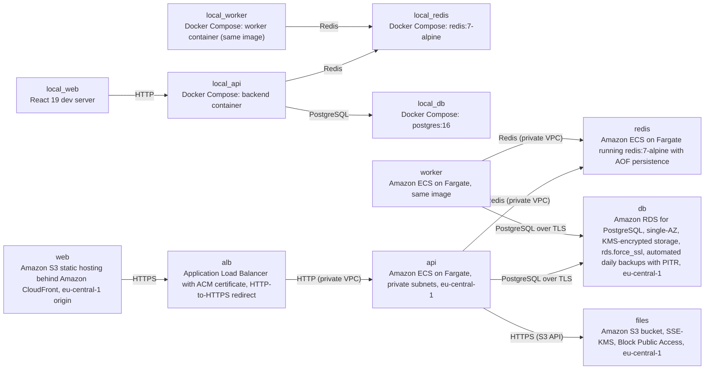

# Deployment Guide

> Maintained by QuorQ AI SDLC. Text between `sdlc:auto` markers is regenerated; anything outside them is yours and is kept.

<!-- sdlc:auto:start how-it-deploys -->
Pushes to `main` run `.github/workflows/deploy.yml`, which builds the API image (if there is a backend) and deploys the SPA to AWS Amplify. Commits touching only `docs/sdlc/**` don't deploy. Deployments can also be started from the platform's Deployment tab.
<!-- sdlc:auto:end how-it-deploys -->

<!-- sdlc:auto:start environments -->
| Name | Service | Runtime | Scaling | Environment |
|---|---|---|---|---|
| local_api | Docker Compose: backend container | FastAPI 0.115 under uvicorn | single container | dev |
| local_worker | Docker Compose: worker container (same image) | RQ worker | single container | dev |
| local_redis | Docker Compose: redis:7-alpine | Redis | single container | dev |
| local_db | Docker Compose: postgres:16 | PostgreSQL 16 | single container | dev |
| local_web | React 19 dev server | Node dev server | single process | dev |
| web | Amazon S3 static hosting behind Amazon CloudFront, eu-central-1 origin | React 19 static build | CDN managed | prod |
| alb | Application Load Balancer with ACM certificate, HTTP-to-HTTPS redirect | AWS managed | managed | prod |
| api | Amazon ECS on Fargate, private subnets, eu-central-1 | FastAPI 0.115 | 1 task (2 optional), no autoscaling (NFR-016) | prod |
| worker | Amazon ECS on Fargate, same image | RQ worker | 1 task | prod |
| redis | Amazon ECS on Fargate running redis:7-alpine with AOF persistence | Redis | 1 task | prod |
| db | Amazon RDS for PostgreSQL, single-AZ, KMS-encrypted storage, rds.force_ssl, automated daily backups with PITR, eu-central-1 | PostgreSQL 16 | single instance (accepted risk NFR-013) | prod |
| files | Amazon S3 bucket, SSE-KMS, Block Public Access, eu-central-1 | Amazon S3 | managed | prod |
<!-- sdlc:auto:end environments -->

<!-- sdlc:auto:start live -->
_Not deployed yet._
<!-- sdlc:auto:end live -->

<!-- sdlc:auto:start topology -->

<!-- sdlc:auto:end topology -->
